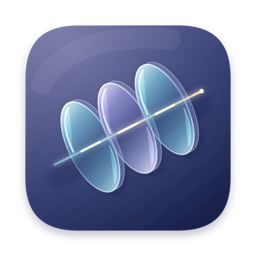
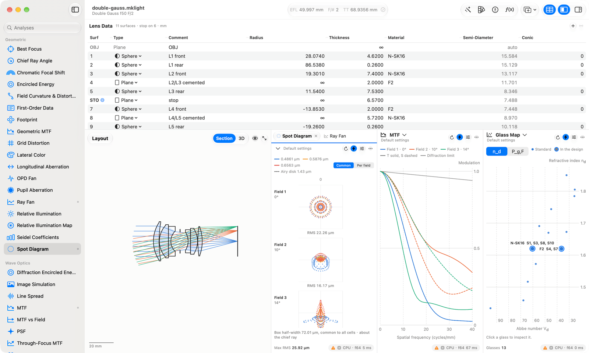
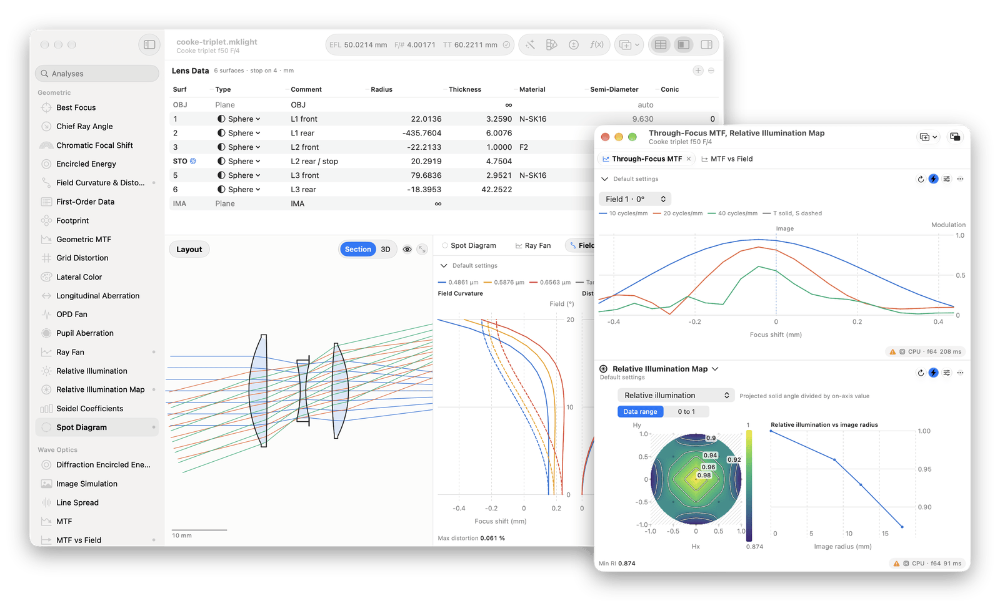
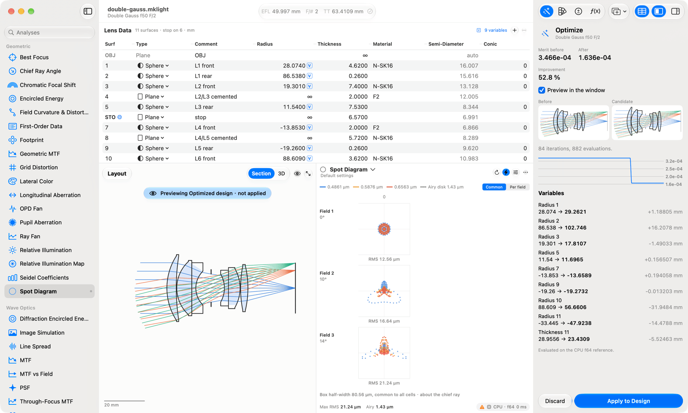
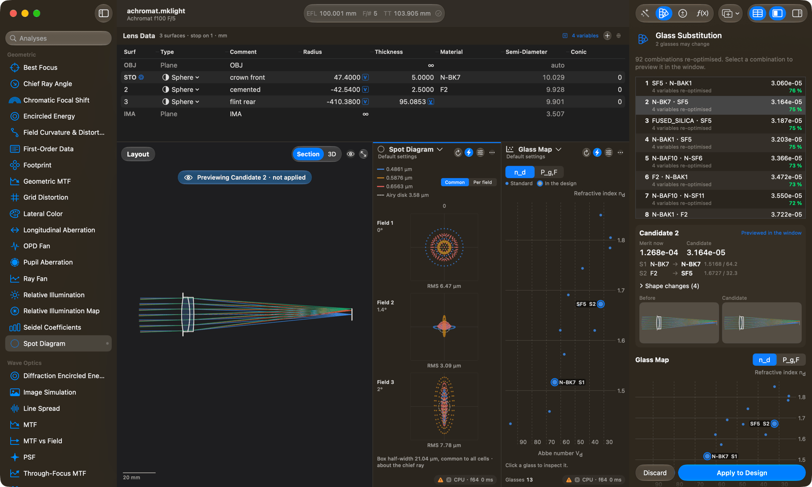
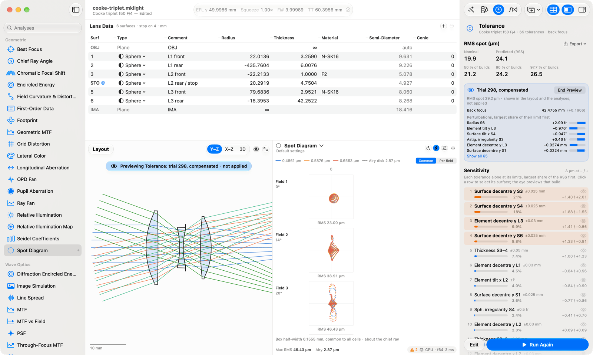
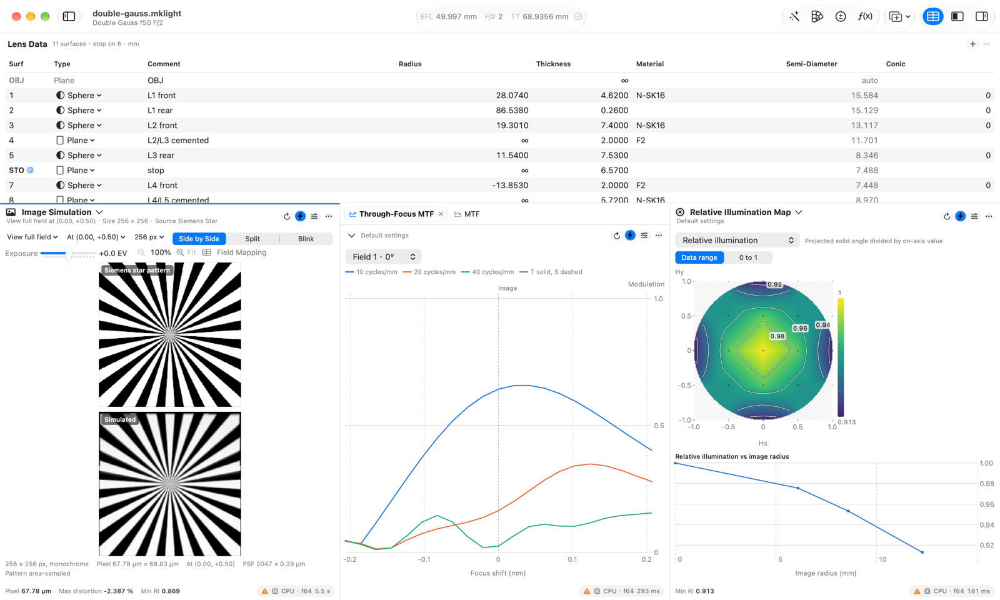
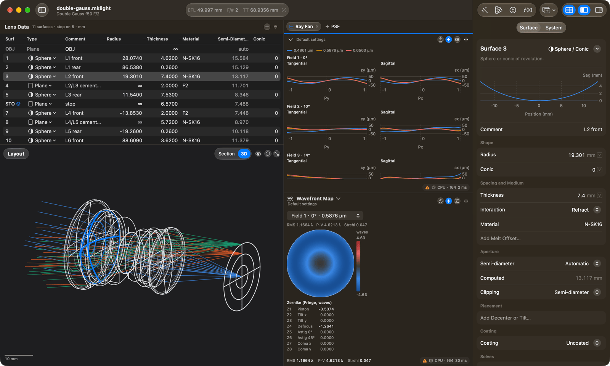
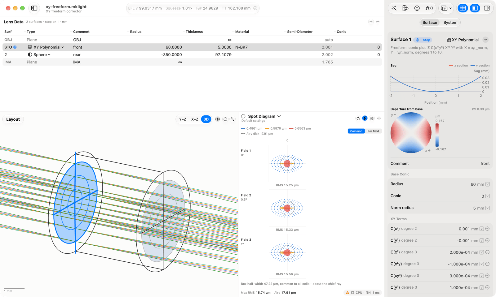

<p align="center">
  
</p>

<h1 align="center">MKLight</h1>

<p align="center">
  Optical design for imaging systems.<br>
  GPU-accelerated, and native on the Mac.
</p>

<p align="center">
  <a href="#features">Features</a> ·
  <a href="#a-closer-look">A closer look</a> ·
  <a href="#command-line-and-python">Scripting</a> ·
  <a href="#documentation">Documentation</a> ·
  <a href="docs/DEVELOPMENT.md">Development</a>
</p>

<p align="center">
  
</p>

MKLight designs, analyses, optimises and tolerances sequential lens systems:
camera lenses, relays, telescopes. Its geometric, wave-optics, ghost and
stray-light solvers all read one physical model, and every analysis redraws
as you edit.

## Features

**Design**<br>
A lens data editor with inline variables, solves and pickups. Surfaces run
from spheres and aspheres to Forbes Q-types, toroids, freeforms and
diffractive phase, with coatings, tilts and decentres, and multiple
configurations.

**Analysis**<br>
More than 40 analyses: spot diagrams and ray fans, MTF and PSF, wavefront
maps, image simulation, relative illumination, polarisation and
transmission.

**Ghosts and stray light**<br>
Ghost paths and ghost irradiance, and non-sequential Monte Carlo stray light
on the optics and the mechanics.

**Optimisation**<br>
Merit functions from a default generator or your own operands. Damped least
squares and trust regions with bounds and constraints, global search, and
glass substitution that re-optimises every combination it tries.

**Tolerancing**<br>
Sensitivities and Monte Carlo yields, with compensators, surface
irregularity and element motions.

**Import and scripting**<br>
Opens `.zmx` and `.seq` prescriptions and AGF glass catalogues. A command
line and Python bindings run on the same engine as the app.

## The app

A native Mac app in SwiftUI, with Liquid Glass and a Metal viewport. Lens
data, the layout and every analysis are panels: drag one onto another to
make a tab, near an edge to split it, or out of the window to give it a
window of its own. Candidate designs from optimisation, glass substitution
or tolerancing are previewed in every panel before you apply them, and
every edit can be undone.

<p align="center">
  
</p>

## A closer look

<table>
<tr>
<td width="50%"><br><sub><b>Optimisation.</b> The result is previewed in the layout and the analyses before you apply it.</sub></td>
<td width="50%"><br><sub><b>Glass substitution.</b> Combinations are ranked by their re-optimised merit; select one to preview it.</sub></td>
</tr>
<tr>
<td><br><sub><b>Tolerancing.</b> Sensitivities and Monte Carlo yields; any trial can be rebuilt and previewed.</sub></td>
<td><br><sub><b>Image quality.</b> Image simulation, through-focus MTF and a relative illumination map.</sub></td>
</tr>
<tr>
<td><br><sub><b>3-D layout.</b> The selected surface is highlighted; ray fans and a wavefront map beside it.</sub></td>
<td><br><sub><b>Freeform surfaces.</b> An XY polynomial corrector with its surface mesh and departure map.</sub></td>
</tr>
</table>

## Under the hood

- **One physical model.** Every solver reads the same system, materials and
  coatings. The sequential, ghost and stray-light solvers each own a class
  of light paths, so their results add up without counting any light twice.
- **A reference behind every result.** A CPU double-precision tracer is the
  reference. The Metal backend switches to double-float arithmetic where
  single precision would miss the accuracy budget, and it is checked against
  the reference on every sample design.
- **The GPU where it pays.** A calibrated cost model sends a job to the GPU
  only when it will finish sooner there. Small, latency-bound work stays on
  the CPU, and a content-hashed cache rebuilds only what an edit changed.
- **Reproducible results.** Every result records the engine version, the
  design's content hash, its settings, the backend and precision it ran on,
  and the random seed.

## Command line and Python

The engine behind the app is also a command-line tool and a Python package.

```bash
mklight new lens.mklight --sample double_gauss
mklight show lens.mklight
mklight run lens.mklight spot_diagram --json
```

```python
import mklight

s = mklight.Engine().new(sample="achromat")
print(mklight.paraxial(s)["efl"])     # 100.0009…
r = s.run("spot_diagram")
print(r.run_info["snapshot_hash"])
```

## Documentation

- **Overview:** [Architecture](docs/ARCHITECTURE.md) ·
  [Conventions](docs/CONVENTIONS.md) · [Decisions](docs/DECISIONS.md)
- **The model:** [Surfaces](docs/SURFACES.md) ·
  [Materials](docs/MATERIALS.md) · [Solves](docs/SOLVES.md) ·
  [Import](docs/IMPORT.md)
- **Image quality:** [Analysis](docs/ANALYSIS.md) ·
  [Wave optics](docs/WAVE.md) · [Polarisation](docs/POLARIZATION.md)
- **Ghosts and stray light:** [Ghosts](docs/GHOST.md) ·
  [Stray light](docs/STRAY.md)
- **Optimisation and tolerancing:** [Optimisation](docs/OPTIMIZATION.md)
- **GPU and results:** [GPU](docs/GPU.md) · [Results](docs/RESULTS.md)
- **Front ends:** [App](docs/APP.md) · [CLI](docs/CLI.md) ·
  [Python](docs/PYTHON.md) · [FFI](docs/FFI.md)
- **Working on MKLight:** [Development](docs/DEVELOPMENT.md)

## Status

MKLight is in active development and has not been released yet; for now it
builds from source, as [Development](docs/DEVELOPMENT.md) describes. The
macOS app and the Metal backend are the current focus. iPad and iPhone
versions of the app, Windows and Linux front ends, and Vulkan and CUDA
backends are planned.

## License

Proprietary. All rights reserved.
